# Архитектура PlayLy

Диаграммы сохранены в SVG для просмотра без поддержки Mermaid; редактируемые исходники `.mmd` лежат рядом в `docs/diagrams/`.

Схемы основаны на `README.md`, `compose.yaml` и текущем коде `backend/` и `ai/`.
Сплошные стрелки показывают реализованные связи или настроенные зависимости инфраструктуры;
пунктирные — запланированное взаимодействие. Core и AI — два серверных сервиса.

## Целевая генерация и исполнение

[Подробная спецификация](docs/game-generation.md) фиксирует TypeScript + Phaser, проверку типов и сборку Vite, изолированный runner с браузерными тестами, модерацию и проверку соответствия запросу через Langfuse, загрузку в RustFS только после допуска и запуск готового JavaScript в Android WebView. AI может использовать заготовки PlayLy и собственные механики. Это целевой процесс; он ещё не реализован. Схемы ниже отражают текущий каркас. Контракт пакета v2 и защищённый отчёт допуска требуют обновления Core и Android.

## Компоненты и потоки данных

[Исходник Mermaid](docs/diagrams/overview.mmd)

AI сейчас отправляет стартовый span и ожидает; Kafka, LLM и генерация пакетов в нём ещё не реализованы.
AI не обращается к PostgreSQL Core. Redis PlayLy развёрнут и настроен для подключения Core,
но бизнес-использование Redis в текущем коде отсутствует, поэтому стрелка к нему не проведена.
В Compose Traefik принимает локальный HTTP на порту 8080; HTTPS предусмотрен спецификацией
для развёртывания. Для загрузки пакетов Android нужен доступный ему адрес RustFS.

## Внутренние модули Core

Это модули одного процесса `backend/`, а не отдельные микросервисы.

[Исходник Mermaid](docs/diagrams/core.mmd)

При сбое после публикации запроса, но до фиксации удаления Outbox, возможна повторная отправка.
Core дедуплицирует входящие события по `eventId`; терминальное состояние задания не меняется
повторным или поздним событием. Версия привязана к уникальному `generationId`.

## Инфраструктура Langfuse

[Исходник Mermaid](docs/diagrams/langfuse.mmd)

PostgreSQL и Redis Langfuse отделены от PostgreSQL и Redis PlayLy.
