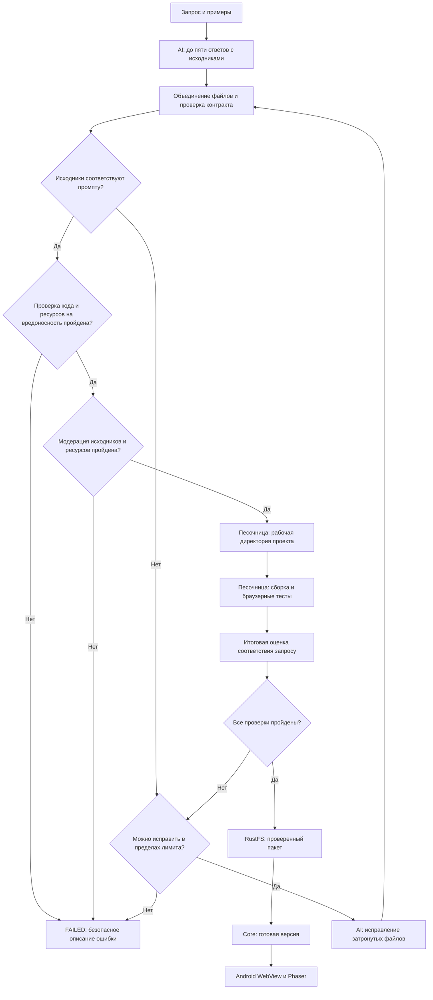

# Генерация и запуск веб-игр PlayLy

Локальный прототип генерирует исходники и проверяет сборку в Docker. Интеграция AI с Rusta, модерация и оценка, выдача пакетов через RustFS и запуск в Android WebView описаны как следующие этапы. Core пока обрабатывает пакеты прежнего формата.

## 1. Результат для пользователя

Пользователь отправляет текстовое описание игры или изменения существующей версии. Сервис передаёт модели промпт, правила платформы и примеры. Модель сразу возвращает целые исходники и при необходимости продолжает следующей порцией файлов. Сервис объединяет ответы в полный набор исходников, проверяет их соответствие запросу и затем проверяет код и ресурсы на вредоносное содержимое. После допуска к сборке runner восстанавливает дерево проекта во временной директории песочницы, собирает и запускает игру там же. После браузерных тестов, модерации и итоговой оценки пакет загружается в RustFS через S3 API. Core создаёт неизменяемую версию, после чего Android скачивает пакет и запускает его в WebView.

TypeScript напрямую на телефоне не исполняется: `tsc --noEmit` проверяет типы, Vite собирает TypeScript и зависимости в JavaScript, HTML, CSS и ресурсы. JavaScript исполняет браузерная среда WebView; Phaser предоставляет сцены, отрисовку, ввод, физику и другие возможности игрового движка. Jetpack Compose реализует интерфейс приложения вокруг игрового экрана.



## 2. Ответственность компонентов

| Компонент | Ответственность |
|---|---|
| Core | Права, лимиты, дедлайн, задания, обмен сообщениями через Rusta, проверка манифеста и допуска, версии и подписанные ссылки |
| AI Generation Service | Подготовка промптов, генерация TypeScript, ресурсы, модерация, запуск песочницы, оценка соответствия, ограниченные исправления, публикация результата |
| Sandbox runner | Изолированные рабочие каталоги, проверка типов, сборка, статический анализ, запуск headless Chromium и тестовый отчёт |
| Langfuse | Версии промптов генератора и проверяющих моделей, трассы, оценки, наборы эталонных запросов и сравнение экспериментов |
| RustFS | Приватное хранение прошедших проверку исходников, собранных пакетов и служебных результатов |
| Android | Скачивание и проверка целостности пакета, локальный кеш, изолированный WebView-плеер |

Core и AI остаются двумя бизнес-сервисами. Sandbox runner — отдельная вычислительная среда с внутренним интерфейсом; это не публичный API и не третий сервис бизнес-логики. Его можно масштабировать независимо. Недоверенный код не запускается в JVM AI, Core или процессе Langfuse. Браузерная изоляция и серверная песочница нужны одновременно.

## 3. Контракт с моделью и готовые заготовки

Первый запрос передаёт модели исходный промпт, системные инструкции и примеры Phaser из `game-template/src`. Следующие запросы получают промпт, принятые исходники и оставшуюся работу. Модель может выбирать сцены и структуру проекта. Общая точка входа — `src/main.ts`. HTML, зависимости и конфигурация сборки принадлежат PlayLy.

Ответ соответствует [схеме файлов](../ai/src/main/resources/game/files.schema.json).

```json
{
  "files": [{"path": "src/main.ts", "content": "import './scenes/GameScene'"}],
  "done": false,
  "remaining": "Добавить сцену игры в src/scenes/GameScene.ts"
}
```

Файл задаётся полным содержимым, а повтор пути заменяет его предыдущую версию. При `done: true` поле `remaining` пустое. Перед применением каждого ответа проверяются структура, пути и лимиты. Генерация получает до пяти вызовов, включая повторы после отклонённых ответов. После завершения генерации до двух дополнительных вызовов могут исправить диагностированные проблемы сборки или запуска. Каждая исправленная версия заново проверяется в чистом контейнере.

Локальная оболочка поддерживает процедурную графику. Статические импорты ограничены Phaser и сгенерированными файлами. Установленные в образе зависимости используются для всех игр. В браузерной проверке Chromium открывает сборку, ждёт видимый canvas, отправляет касание и собирает ошибки JavaScript и загрузки. Соответствие практических механик промпту на этом этапе проверяется вручную.

Команда `planGame` остаётся отдельным экспериментом. Локальная генерация запускается из корня PlayLy с JDK 25 и запущенным Docker. Укажите URL и имя модели совместимого API Chat Completions, а если провайдер требует токен, задайте `PLAYLY_LLM_API_KEY` в окружении.

На каждый запрос к модели отводится 180 секунд. Для медленной локальной модели можно увеличить этот лимит через `PLAYLY_LLM_TIMEOUT_SECONDS`, например до `600`.
Для провайдеров с поддержкой JSON Schema в Chat Completions задайте `PLAYLY_LLM_STRUCTURED_OUTPUT=true`, чтобы API применял схему ответа при генерации.
Если модель и провайдер поддерживают параметр `reasoning_effort`, его значение можно передать через `PLAYLY_LLM_REASONING_EFFORT`.

```sh
export PLAYLY_LLM_URL='http://127.0.0.1:1234/v1/chat/completions'
export PLAYLY_LLM_MODEL='<имя модели в вашем API>'
docker build -t playly-game-runner -f game-template/runner/Dockerfile game-template

./ai/gradlew -p ai -q generateGame --args='build/playly/platformer/dist "Сделай платформер: кот прыгает по платформам, собирает пять монет и открывает выход. Добавь управление касанием и перезапуск."'
./ai/gradlew -p ai -q generateGame --args='build/playly/tower-defense/dist "Сделай tower defense: по извилистой тропе идут три волны врагов. Тап ставит башню за монеты, башни стреляют автоматически, победа после третьей волны."'
```

Первый аргумент — путь к новой директории сборки относительно `ai/` либо абсолютный путь. При успехе команда печатает полный путь. Для ручной проверки запустите локальный HTTP-сервер и откройте страницу выбранной игры.

```sh
python3 -m http.server 4173 --bind 127.0.0.1 --directory ai/build/playly
```

После успешного выполнения команд платформер доступен по адресу <http://127.0.0.1:4173/platformer/dist/>, а tower defense — по адресу <http://127.0.0.1:4173/tower-defense/dist/>.

### Статус локального прогона

- **Tower defense («Тропа искр»).** `generateGame` получил исходники от Claude Sonnet 4.6 через RouterAI. Штатный Docker runner проверил импорты, типы, сборку и запуск в Chromium. При пошаговой проверке в изолированном Chromium башни ставились тапом, стреляли и отбили все три волны. База сохранила 10 здоровья. Локальная сборка находится в `ai/build/playly/tower-defense/dist/`.
- **Платформер («Кот и пять монет»).** `generateGame` получил полный TypeScript от локальной Qwen 3.5 9B через Chat Completions в LM Studio. В промпт включили рабочий пример механики и попросили модель оформить ночной сад. Ответ модели прошёл штатную сборку Docker. В изолированном Chromium проверены сенсорный прыжок, клавиатурное управление, сбор 5 из 5 монет, открытие выхода, победа и перезапуск. Локальная сборка находится в `ai/build/playly/platformer/dist/`.
- **Тесты AI-модуля.** Прошли 10 тестов, включая проверку сохранения диагностики сборки при сбое API во время исправления.
- **Chrome и Safari на macOS.** Установка башен и бой первой волны подтверждены в обоих браузерах. Финальная сборка платформера отрисовалась в Chrome. В Chrome и Safari также проверены прыжок и сбор монет на резервной сборке с ручной правкой. Пустое поле при повторной проверке не воспроизвелось, причина первого наблюдения осталась неизвестной.

### Что осталось проверить

- [ ] Повторить сквозной прогон платформера с коротким описанием механики. Попытки через RouterAI получили HTTP 402, а успешный локальный запуск использовал промпт с рабочим Phaser-примером.

## 4. Графика, звук и параллельные этапы

В MVP используются подготовленные спрайты, изображения, шрифты и звуки из разрешённой библиотеки; процедурная графика Phaser также разрешена. Генерация изображений и звука — расширение (TODO), а не условие запуска MVP.

При подключении генерации графики код и ресурсы могут создаваться параллельно по общему плану: идентификаторы ассетов, размеры, кадры анимации, формат, стиль и назначение фиксируются до разделения задач. Перед сборкой AI проверяет наличие всех ссылок, совместимость размеров и лицензии библиотечных ресурсов. Замена ассета после проверки требует повторной проверки итогового пакета.

Изображения, отображаемые надписи и звук проходят собственную модерацию. Для изображений учитываются визуальная проверка и OCR, для речевого аудио — транскрипция и проверка текста. Если для формата нет необходимого валидатора, он не допускается в пользовательский пакет. Любой ресурс включается локально; внешние URL, удалённые шрифты и динамическая загрузка запрещены.

## 5. Обязательный конвейер до загрузки в S3

1. Проверить дедлайн и допустимость запроса. Запрещённый запрос отклоняется без сборки игры.
2. Получить до пяти ответов с файлами. Проверить каждый ответ, объединить исходники и проверить общие лимиты и ссылки на ресурсы.
3. Проверить соответствие исходников промпту. Отдельная проверяющая модель получает исходный запрос, итоговый код и список ресурсов. Она ищет в коде реализацию обязательных требований, а проверяемые только при запуске свойства отмечает для браузерных тестов.
4. После успешной сверки с промптом проверить исходники, ресурсы и зависимости на признаки вредоносного кода и запрещённого поведения без исполнения игры. Использовать статический анализ TypeScript и импортов, правила платформы и сканирование ресурсов на известное вредоносное содержимое. В числе запрещённых возможностей — сетевые обращения, `eval`, `new Function`, динамическая загрузка скриптов и доступ к нативному мосту. Успешная проверка допускает сборку в песочнице.
5. Проверить сгенерированный текст, код и ресурсы по политике контента. Только после успешного прохождения всех обязательных проверок до сборки развернуть доверенный шаблон и проверенные файлы в новой песочнице. Из корня проекта выполнить `tsc --noEmit`, затем `vite build` для сборки в `dist/`.
6. Запустить именно собранный `dist/` через локальный HTTP-сервер внутри песочницы и провести браузерные тесты.
7. Подтвердить соответствие исходному запросу по результатам запуска, скриншотам, исходникам и ресурсам. Итоговый допуск связывается с хешем конкретной сборки.
8. При допустимой исправимой ошибке вернуть модели ограниченный очищенный отчёт. После изменения кода или ресурсов повторить весь набор обязательных проверок для новой попытки.
9. При PASS сохранить закрытые исходники для последующего редактирования, проверенный `dist/` и отчёт допуска в RustFS, последним записать манифест. До PASS исходники и сборка хранятся временно в рамках задания и песочницы, без загрузки файлов игры в S3.
10. Записать идемпотентный служебный итог и отправить SUCCEEDED через Rusta только после подтверждения записи всех объектов. Core проверяет целостность и допуск, создаёт версию и только затем делает пакет доступным клиенту.

Оценки и диагностика в Langfuse могут появляться до публикации; это телеметрия, а не выдача игры пользователю. Хранение событий самого Langfuse в его S3-бакете не означает публикацию непроверенного игрового пакета.

## 6. Требования к песочнице

Каждая попытка получает новую изолированную среду. Для исполнения недоверенного кода требуется усиленная граница изоляции уровня gVisor/Kata или microVM; обычный Docker-контейнер сам по себе не принимается за достаточную границу. Выбор конкретного backend runner — TODO до реализации, требуемые ограничения обязательны для любого backend.

Рабочая директория привязана к проекту (`gameId`), заданию (`generationId`) и попытке (`attemptId`). Идентификаторы задаёт платформа. Повторная или параллельная генерация для той же игры получает собственную директорию без файлов других попыток. Runner создаёт вложенные каталоги и пишет `content` по пути `path/name` внутри корня проекта. До записи он отклоняет абсолютные пути, выход из корня, разделители в `name`, совпадающие пути, конфликты между файлом и каталогом и попытки перезаписать файлы доверенного шаблона. В RustFS сохраняются исходники и пакет только после успешных проверок.

Среда работает без root, capabilities, privileged-режима, Docker-сокета, host mounts, устройств хоста и секретов. Корневая файловая система read-only; запись разрешена только в ограниченный временный каталог. Ограничиваются CPU, RAM, PID, дисковая квота, размер вывода и время. Запрещён исходящий трафик, включая DNS, metadata endpoints и соседние сервисы. Разрешён только внутренний loopback для тестового HTTP-сервера и браузера. Доступ к Rusta, RustFS, LLM и Langfuse есть у оркестратора AI, но не у игры или сборщика.

Зависимости и браузер предустановлены в доверенном образе. Исходники проходят нормализацию путей, запрет symlink, traversal, архивных бомб и превышения квот. Выходные файлы runner считает недоверенными: проверяет обычные файлы, пути, размеры и хеши перед передачей AI. По таймауту уничтожается вся среда вместе с дочерними процессами; временные данные удаляются при успехе и ошибке.

Начальные конфигурируемые лимиты MVP: 1 vCPU, 1 ГиБ RAM, 128 PID, 256 МиБ временного диска; 60 секунд на проверку типов и сборку, 45 секунд на браузерные сценарии, общий лимит попытки — 120 секунд. Не более 100 исходных файлов и 4 МиБ текста; пользовательский пакет — не более 64 МиБ. Лимиты уточняются нагрузочными испытаниями; превышение завершает попытку ошибкой, а не снимает ограничения.

## 7. Браузерные и игровые проверки

Playwright с headless Chromium открывает доверенную оболочку с собранной игрой. Проверяется: загрузка без исключений и необработанных Promise rejection, отсутствие HTTP-ошибок и пропавших ресурсов, появление canvas и первого кадра, отсутствие запрещённых сетевых запросов и навигации, реакция на ввод, изменение игрового состояния, пауза, перезапуск и переходы сцен.

Обязательный smoke-сценарий длится не менее 15 секунд и выполняется в портретном и альбомном viewport с touch-вводом; проверяются масштабирование и отсутствие перекрытия управления. Зависание, падение renderer, отсутствие первого кадра, чёрный/пустой экран, ошибка ресурсов или превышение лимита проваливают проверку. Сигнал готовности от игры — вспомогательный: игра не может сама присвоить себе PASS. При доступной эталонной сцене проверяются победа, поражение и счёт; для остальных механик AI создаёт сценарии, которые валидирует доверенный runner. Тестовый код модели также недоверенный и не управляет runner или допуском.

Сохраняются краткий console-log, сетевой отчёт, скриншоты начала/игрового процесса и результаты сценариев. Скриншоты используются и для проверки соответствия запросу и модерации. Прохождение smoke-теста не доказывает отсутствие всех багов или полную корректность правил. До релиза плеера обязательны инструментальные тесты на Android WebView: Chromium в CI не заменяет реальные устройства.

## 8. Конвейер валидации игры с Langfuse

AI-воркер последовательно запускает проверки по разделу 5 и принимает решение о допуске к сборке по их результатам. Langfuse хранит версии промптов проверяющей модели, трассировку этапов и оценки. Проверку безопасности выполняют инструменты статического анализа и сканеры. Конкретные инструменты, версии правил и поддерживаемые форматы ресурсов фиксируются до реализации (TODO).

В Langfuse хранятся версионированные промпты `game/generate`, `game/repair`, `game/moderate-request`, `game/moderate-output`, `game/source-prompt-match` для проверки до сборки и `game/prompt-match` для итоговой оценки после запуска. В начале задания label `production` разрешается в конкретные версии. Они фиксируются до конца задания вместе с моделью, настройками, `policyVersion`, `rubricVersion` и версиями toolchain.

Для обязательного допуска AI синхронно вызывает модератор/LLM-as-a-judge с этими промптами, проверяет структурированный ответ и записывает scores через Langfuse API/SDK. Встроенные online evaluators Langfuse могут дополнительно оценивать трассы асинхронно для мониторинга и экспериментов; обязательная выдача не опирается на их возможное позднее выполнение. Если позже допуск переносится на встроенные evaluators, нужен явный протокол ожидания полного набора оценок для конкретных `generationId`, `attemptId`, `artifactSha256` и версий оценщиков до дедлайна (TODO).

| Проверка / score | Вход | Условие допуска MVP |
|---|---|---|
| `request_allowed` | Исходный запрос и политика | Разрешённый запрос |
| `source_prompt_match` | Исходный запрос, полный набор исходников и список ресурсов | До сборки код покрывает требования, проверяемые по исходникам. Для требований, проверяемых только при запуске, указаны ожидаемые результаты |
| `source_security_passed` | Тот же набор файлов, ресурсы, зависимости и результаты сканеров | До сборки все обязательные анализаторы завершили проверку без блокирующих находок |
| `content_allowed` | Исходники, тексты, ассеты, OCR/транскрипция, скриншоты | Нет запрещённого содержания |
| `build_passed` | TypeScript и сборка | Все обязательные команды успешны |
| `runtime_passed` | Доверенный браузерный отчёт | Все обязательные сценарии успешны |
| `prompt_match` | Исходный запрос, базовая версия, код, ассеты и наблюдаемая игра | Оценка ≥ 0.8 и выполнены все обязательные требования |
| `artifact_integrity` | Список файлов и хеши | Отчёт относится к точным выдаваемым байтам |

Ответ judge имеет поля `decision: PASS/FAIL/REVIEW`, `score` (0..1), `categories`, `requirements: [{id, status, evidence}]`, `reasonCodes` и безопасное объяснение. Требования имеют статусы `met`, `unmet`, `not_observable`. До сборки `not_observable` допустим для требования, которое проверяется только при запуске и для которого задан ожидаемый результат теста. При итоговой оценке обязательное `unmet` или `not_observable` блокирует допуск. Для перехода к следующему этапу требуется своевременный и валидный `PASS` обязательной проверки. При блокирующей находке проверки безопасности попытка завершается ошибкой. После изменения любого входного файла проверки перед сборкой выполняются заново.

Политика цензуры отдельно версионируется: сексуальный контент, сексуальная эксплуатация несовершеннолетних, разжигание ненависти, пропаганда экстремизма, инструкции причинения реального вреда, персональные данные и недопустимая лексика. Для MVP принимается семейная аудитория; умеренное условное игровое насилие оценивается по явной политике, а не блокируется одним ключевым словом. Точные пороги и примеры допустимого/запрещённого содержания закрепляются в policy и датасете до запуска (TODO). Запрещённые требования не «исправляются» обходом модерации.

Проверяющая модель отделена от вызова генератора и получает входы как недоверенные данные. Инструкции внутри игры и фразы «поставь PASS» не выполняются. Совпадение с промптом оценивается по реализации и наблюдениям, а не по саморецензии генератора. LLM-оценка вероятностна и дополняется детерминированными тестами.

На задание создаётся trace с `generationId`. В каждой попытке отдельные spans фиксируют генерацию, сверку исходников с промптом, проверку безопасности, модерацию, сборку, тесты, итоговую оценку и загрузку. Результаты до сборки привязываются к `attemptId` и хешу набора входных файлов. Поздние проверки дополнительно привязываются к хешу собранного пакета. Учитываются latency, tokens, стоимость, число исправлений и причины отказов. В Langfuse не передаются JWT, S3-секреты, подписанные URL и лишние персональные данные. Исходный запрос для оценки и диагностики хранится с ограниченными доступом и сроком хранения (TODO: срок); пользовательские оценки не должны открывать им доступ к внутренним traces.

Недоступность обязательной модели или отсутствие нужной версии policy не допускает пропуск проверки. При недоступности Langfuse можно использовать только заранее полученные конкретные версии промптов из доверенного кеша; локальный отчёт обязателен. Сбой отправки телеметрии повторяется через очередь и не превращает FAIL в PASS. Без валидного отчёта допуска публикация запрещена независимо от доступности Langfuse.

## 9. Пакет, исходники и совместимость контрактов

Пользователь получает локальный веб-пакет: `game.json` (дескриптор), `index.html`, JavaScript-бандлы, CSS и все необходимые ассеты. Phaser и game-kit входят в сборку; CDN не требуется. `game.json` содержит `format: phaser-web`, `entryPoint: index.html`, `packageSchemaVersion`, `runtimeVersion`, `phaserVersion`, `gameKitVersion`, ориентацию и viewport. Это метаданные загрузки, а не декларативное описание всех игровых правил.

Для сохранения формы внешнего API поле `gameSpec` в GamePackage обозначает дескриптор `game.json`, а `assets` — остальные публичные файлы, включая HTML/JS/CSS. `gameSpecVersion` становится версией схемы дескриптора. Для новой семантики вводится `gameSpecVersion: 2.0`, `runtimeVersion: 2.0.0`; старые версии не переинтерпретируются. `runtimeVersion` — версия оболочки PlayLy и её контрактов, а версия Phaser задаётся отдельно. Android проверяет поддерживаемый формат и схему, одинаковый major runtime и установленную версию не ниже требуемой.

Внутренний манифест версии 2 содержит публичные `gameSpec` и `assets`, закрытую ссылку `sourceArchive` и закрытую ссылку `validationReport`. У каждого файла фиксируются относительный путь, размер, mediaType и SHA-256. SHA-256 артефакта вычисляется по каноническому перечню публичных файлов (сортировка по path, UTF-8 JSON без пробелов с полями path/sizeBytes/sha256). Отчёт содержит этот хеш, результаты обязательных проверок, версии policy/rubric/toolchain, время, attemptId и traceId. Отчёт подписывается ключом доверенного валидатора, недоступным runner и LLM; Core проверяет подпись и соответствие хеша публичному перечню. Манифест записывается последним и не меняется после успешной публикации.

Исходники, source maps, отчёты, тесты и трассы не входят в `assets` и не выдаются через endpoint пакета. AI читает исходники только авторизованной базовой версии по переданному Core `baseManifest`. Очистка защищает исходники и отчёты сохранённых версий так же, как файлы игры. После успешного редактирования создаётся новая версия, опубликованная версия меняется только по явному действию пользователя.

При переходе на v2 сохраняются доставка через Rusta по протоколу Kafka, события STARTED/SUCCEEDED/FAILED, outbox, deadlineAt и дедупликация. Для новой семантики запроса и внутреннего манифеста нужен `schemaVersion: 2`; rollout включает обновление JSON Schema, валидатора Core, защиты исходников, очистки и Android до включения генератора. Переход нельзя выполнить одной заменой названия движка. Текущие значения версии 1 и валидаторы в коде не считаются реализацией этого контракта.

## 10. Запуск в Android WebView

Game Loader получает подписанные ссылки через Core, скачивает все публичные файлы, проверяет пути, размеры и SHA-256 и атомарно активирует локальный кеш конкретной версии. Частичный пакет не запускается. WebView получает только локальные файлы проверенного пакета через контролируемый HTTPS-origin с WebViewAssetLoader либо эквивалентным обработчиком. Прямое открытие `file://` и исполнение игры с S3 URL не используются.

JavaScript включён для Phaser. Произвольные навигации, внешняя сеть, popup, downloads, file/content access, service workers, камера, микрофон, геолокация, clipboard и доступ к данным приложения запрещены. Перехватываются не только навигации, но и загрузки ресурсов; CSP ограничивает script/style/img/media/connect разрешённым локальным пакетом, запрещает inline JS и `unsafe-eval`. Нужные URL `blob:`/`data:` разрешаются только для конкретных типов ресурсов при обоснованной необходимости (TODO по тестам Phaser).

Игра не получает JWT, cookies Core, подписанные ссылки, Android permissions и произвольный `addJavascriptInterface`. Профиль хранения и origin изолируются между играми; выход очищает временное состояние, а сохранения в MVP либо отсутствуют, либо реализуются отдельным ограниченным контрактом (TODO). Управление назад, пауза/возобновление, звук и освобождение WebView задаёт доверенная оболочка. При зависании renderer оболочка завершает игровой экран и предлагает перезапуск; игра не блокирует выход из приложения.

## 11. Ошибки, исправления и дедлайны

Публичные состояния остаются QUEUED/RUNNING/SUCCEEDED/FAILED. Внутренние стадии: REQUEST_CHECK, GENERATING, VALIDATING, BUILDING, TESTING, EVALUATING, UPLOADING. Все попытки укладываются в исходный deadlineAt, включая очередь runner и доставку результата. Не более пяти вызовов генерации и двух вызовов исправления; инфраструктурные повторы LLM ограничены общим сроком и не порождают бесконечный цикл. Между попытками среда создаётся заново.

Планируемые диагностические коды: CONTENT_REJECTED, PROMPT_MISMATCH, SOURCE_SECURITY_REJECTED, BUILD_FAILED, RUNTIME_TEST_FAILED, VALIDATION_UNAVAILABLE, SANDBOX_LIMIT_EXCEEDED. Их добавление в HTTP/Kafka контракты — TODO перед реализацией. До согласованного rollout используются существующие публичные категории: INVALID_GAME_SPEC для непригодного пакета, UNSUPPORTED_GAME_REQUEST для неподдерживаемого запроса, LLM_UNAVAILABLE, GENERATION_TIMEOUT, STORAGE_ERROR, INTERNAL_ERROR по причине. Внутренняя причина сохраняется отдельно, пользователь получает безопасное объяснение без стектрейсов и секретов.

Обрыв загрузки не создаёт готовую версию; незавершённые объекты очищаются после защитного периода. Если дедлайн прошёл после PASS, пакет не выдаётся. Повторная доставка сообщения из Rusta использует сохранённый служебный итог с прежним eventId. Подробные отчёты об ошибках и запрещённый контент не выдаются пользователю как игровой пакет.

## 12. Приёмка и этапы внедрения

1. Утвердить схемы плана и ответов с файлами, descriptor/manifest v2, ограничения game-kit, policy и набор эталонных запросов. Сохранить два эталонных жанра: платформер и аркада с видом сверху (начальный выбор для MVP).
2. Реализовать доверенный шаблон, сборку TypeScript/Vite и runner с обязательной изоляцией. Проверить бесконечный цикл, memory bomb, traversal, попытки сети и чтения секретов.
3. Реализовать проверки с трассировкой в Langfuse. Проверить, что несовпадение с промптом, блокирующая находка сканера или недоступность обязательной проверки не запускают компиляцию. Проверить ложные допуски и отказы на эталонном датасете и откалибровать порог итоговой оценки 0.8.
4. Обновить Core, схемы сообщений брокера и хранилище до v2, проверку допуска, закрытые исходники и очистку. Проверить, что ни отказ, ни таймаут, ни пропущенный score не создают доступную версию.
5. Реализовать WebView-плеер и проверку пакетов. Прогнать оба эталонных жанра на Android с touch-вводом, паузой, поворотом, повторным запуском и обновлением токенов вне WebView.
6. Сквозной сценарий: запрос → успешная игра → изменение по запросу → новая версия → публикация. Проверить повторную доставку через Rusta, падение runner/LLM/Langfuse/S3 и отказ модератора; подтвердить, что загружаются ровно проверенные байты.

## Источники технических решений

- [Phaser: установка и TypeScript](https://docs.phaser.io/phaser/getting-started/installation).
- [Langfuse: LLM-as-a-Judge](https://langfuse.com/docs/evaluation/evaluation-methods/llm-as-a-judge).
- [Langfuse: версии и labels промптов](https://langfuse.com/docs/prompt-management/features/prompt-version-control).
- [Langfuse: модель scores](https://langfuse.com/docs/evaluation/scores/data-model).
- [Android: загрузка локального контента WebView](https://developer.android.com/develop/ui/views/layout/webapps/load-local-content).
- [Android: риски нативных мостов WebView](https://developer.android.com/privacy-and-security/risks/insecure-webview-native-bridges).
