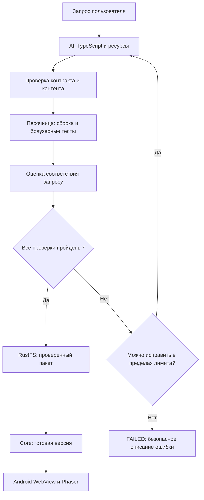

# Генерация и запуск веб-игр PlayLy

Статус: целевая спецификация. Описывает переход с декларативного GameSpec/libGDX на TypeScript, Phaser и Android WebView. Генератор, песочница, проверки и WebView-плеер ещё требуют реализации; действующий Core пока обрабатывает прежний формат пакета. При расхождении описаний процесса генерации этот документ имеет приоритет над прежними описаниями GameSpec.

## 1. Результат для пользователя

Пользователь отправляет текстовое описание игры или изменения существующей версии. AI возвращает исходный код TypeScript и описание используемых ресурсов. Сервер проверяет ответ, собирает и запускает игру в изолированной песочнице, проверяет содержание и соответствие запросу. Только прошедший все обязательные проверки пакет загружается в RustFS через S3 API. Core создаёт неизменяемую версию, после чего Android скачивает пакет и запускает его в WebView.

TypeScript напрямую на телефоне не исполняется: `tsc --noEmit` проверяет типы, Vite собирает TypeScript и зависимости в JavaScript, HTML, CSS и ресурсы. JavaScript исполняет браузерная среда WebView; Phaser предоставляет сцены, отрисовку, ввод, физику и другие возможности игрового движка. Jetpack Compose реализует интерфейс приложения вокруг игрового экрана.

## 2. Ответственность компонентов

| Компонент | Ответственность |
|---|---|
| Core | Права, лимиты, дедлайн, задания, Kafka, проверка манифеста и допуска, версии и подписанные ссылки |
| AI Generation Service | Подготовка промптов, генерация TypeScript, ресурсы, модерация, запуск песочницы, оценка соответствия, ограниченные исправления, публикация результата |
| Sandbox runner | Изолированные рабочие каталоги, проверка типов, сборка, статический анализ, запуск headless Chromium и тестовый отчёт |
| Langfuse | Версии промптов генератора и проверяющих моделей, трассы, оценки, наборы эталонных запросов и сравнение экспериментов |
| RustFS | Приватное хранение прошедших проверку исходников, собранных пакетов и служебных результатов |
| Android | Скачивание и проверка целостности пакета, локальный кеш, изолированный WebView-плеер |

Core и AI остаются двумя бизнес-сервисами. Sandbox runner — отдельная вычислительная среда с внутренним интерфейсом; это не публичный API и не третий сервис бизнес-логики. Его можно масштабировать независимо. Недоверенный код не запускается в JVM AI, Core или процессе Langfuse. Браузерная изоляция и серверная песочница нужны одновременно.

## 3. Контракт с моделью и готовые заготовки

Модель получает пользовательский запрос, ограничения платформы, целевые версии, описание Phaser API, библиотеку заготовок и ресурсов. Для редактирования добавляются исходники конкретной базовой версии и список требуемых изменений. Исходники и пользовательский запрос считаются данными и не могут изменять правила проверки, системный промпт или настройки инфраструктуры.

Ответ имеет структурированный конверт JSON: `responseVersion`, `entryPoint`, `files: [{path, content}]`, `assetRefs`, `requirements: [{id, description}]`. `files` содержит TypeScript и разрешённые данные; исходная точка входа — `src/main.ts`. Никаких Markdown-ограждений, команд оболочки или произвольных файлов вне контракта. Конкретная JSON Schema конверта должна быть добавлена до реализации генератора (TODO).

Модель может импортировать `phaser` и версионированный пакет `@playly/game-kit`. Заготовки включают управление касанием, виртуальные кнопки, сцены меню и паузы, счёт, здоровье, таймеры, загрузку ресурсов и примеры жанров. Модель может использовать заготовки, комбинировать их и писать собственные сцены и механики в рамках разрешённых возможностей Phaser. Перечень готовых шаблонов не является закрытым перечнем игровых механик.

`package.json`, lockfile, `tsconfig`, Vite-конфигурация, HTML-оболочка, CSP и тестовый harness предоставляются платформой. Модель не может менять их, добавлять npm-зависимости, плагины сборки, lifecycle-скрипты, Node.js-модули или загружать код с CDN. Версии Node.js, TypeScript, Vite, Phaser и game-kit закрепляются в доверенном образе сборки и lockfile; `npm install` для каждого ответа модели не выполняется.

AI формирует проверяемый список требований из исходного запроса. Проверяющая модель сверяет его с самим запросом: список, подготовленный генератором, не может исключать неудобные требования. Неподдерживаемые возможности объясняются пользователю, а не молча подменяются.

## 4. Графика, звук и параллельные этапы

В MVP используются подготовленные спрайты, изображения, шрифты и звуки из разрешённой библиотеки; процедурная графика Phaser также разрешена. Генерация изображений и звука — расширение (TODO), а не условие запуска MVP.

При подключении генерации графики код и ресурсы могут создаваться параллельно по общему плану: идентификаторы ассетов, размеры, кадры анимации, формат, стиль и назначение фиксируются до разделения задач. Перед сборкой AI проверяет наличие всех ссылок, совместимость размеров и лицензии библиотечных ресурсов. Замена ассета после проверки требует повторной проверки итогового пакета.

Изображения, отображаемые надписи и звук проходят собственную модерацию. Для изображений учитываются визуальная проверка и OCR, для речевого аудио — транскрипция и проверка текста. Если для формата нет необходимого валидатора, он не допускается в пользовательский пакет. Любой ресурс включается локально; внешние URL, удалённые шрифты и динамическая загрузка запрещены.

## 5. Обязательный конвейер до загрузки в S3

1. Проверить дедлайн и допустимость запроса. Запрещённый запрос отклоняется без сборки игры.
2. Получить структурированный ответ модели и проверить схему, пути, количество файлов, размеры и ссылки на ресурсы.
3. Выполнить статический анализ TypeScript и зависимостей: разрешённые импорты, отсутствие сетевых обращений, `eval`, `new Function`, динамической загрузки скриптов и доступа к нативному мосту. Статический анализ не считается доказательством безопасности.
4. Проверить сгенерированный текст, код и ресурсы по политике контента.
5. Передать исходники и ресурсы в новую песочницу; выполнить `tsc --noEmit` и `vite build` доверенной конфигурацией. Vite сам по себе не заменяет проверку типов.
6. Запустить именно собранный `dist/` через локальный HTTP-сервер внутри песочницы и провести браузерные тесты.
7. Проверить соответствие исходному запросу по коду, ресурсам, скриншотам и результатам сценариев. Итоговый допуск связывается с хешем конкретной сборки.
8. При допустимой исправимой ошибке вернуть модели ограниченный очищенный отчёт. После изменения кода или ресурсов повторить весь набор обязательных проверок для новой попытки.
9. При PASS сохранить закрытые исходники для последующего редактирования, проверенный `dist/` и отчёт допуска в RustFS, последним записать манифест. До PASS исходники и сборка остаются только во временном хранилище песочницы, без загрузки файлов игры в S3.
10. Записать идемпотентный служебный итог и отправить SUCCEEDED через Kafka только после подтверждения записи всех объектов. Core проверяет целостность и допуск, создаёт версию и только затем делает пакет доступным клиенту.

Оценки и диагностика в Langfuse могут появляться до публикации; это телеметрия, а не выдача игры пользователю. Хранение событий самого Langfuse в его S3-бакете не означает публикацию непроверенного игрового пакета.

## 6. Требования к песочнице

Каждая попытка получает новую изолированную среду. Для исполнения недоверенного кода требуется усиленная граница изоляции уровня gVisor/Kata или microVM; обычный Docker-контейнер сам по себе не принимается за достаточную границу. Выбор конкретного backend runner — TODO до реализации, требуемые ограничения обязательны для любого backend.

Среда работает без root, capabilities, privileged-режима, Docker-сокета, host mounts, устройств хоста и секретов. Корневая файловая система read-only; запись разрешена только в ограниченный временный каталог. Ограничиваются CPU, RAM, PID, дисковая квота, размер вывода и время. Запрещён исходящий трафик, включая DNS, metadata endpoints и соседние сервисы. Разрешён только внутренний loopback для тестового HTTP-сервера и браузера. Доступ к Kafka, RustFS, LLM и Langfuse есть у оркестратора AI, но не у игры или сборщика.

Зависимости и браузер предустановлены в доверенном образе. Исходники проходят нормализацию путей, запрет symlink, traversal, архивных бомб и превышения квот. Выходные файлы runner считает недоверенными: проверяет обычные файлы, пути, размеры и хеши перед передачей AI. По таймауту уничтожается вся среда вместе с дочерними процессами; временные данные удаляются при успехе и ошибке.

Начальные конфигурируемые лимиты MVP: 1 vCPU, 1 ГиБ RAM, 128 PID, 256 МиБ временного диска; 60 секунд на проверку типов и сборку, 45 секунд на браузерные сценарии, общий лимит попытки — 120 секунд. Не более 100 исходных файлов и 4 МиБ текста; пользовательский пакет — не более 64 МиБ. Лимиты уточняются нагрузочными испытаниями; превышение завершает попытку ошибкой, а не снимает ограничения.

## 7. Браузерные и игровые проверки

Playwright с headless Chromium открывает доверенную оболочку с собранной игрой. Проверяется: загрузка без исключений и необработанных Promise rejection, отсутствие HTTP-ошибок и пропавших ресурсов, появление canvas и первого кадра, отсутствие запрещённых сетевых запросов и навигации, реакция на ввод, изменение игрового состояния, пауза, перезапуск и переходы сцен.

Обязательный smoke-сценарий длится не менее 15 секунд и выполняется в портретном и альбомном viewport с touch-вводом; проверяются масштабирование и отсутствие перекрытия управления. Зависание, падение renderer, отсутствие первого кадра, чёрный/пустой экран, ошибка ресурсов или превышение лимита проваливают проверку. Сигнал готовности от игры — вспомогательный: игра не может сама присвоить себе PASS. При доступной эталонной сцене проверяются победа, поражение и счёт; для остальных механик AI создаёт сценарии, которые валидирует доверенный runner. Тестовый код модели также недоверенный и не управляет runner или допуском.

Сохраняются краткий console-log, сетевой отчёт, скриншоты начала/игрового процесса и результаты сценариев. Скриншоты используются и для проверки соответствия запросу и модерации. Прохождение smoke-теста не доказывает отсутствие всех багов или полную корректность правил. До релиза плеера обязательны инструментальные тесты на Android WebView: Chromium в CI не заменяет реальные устройства.

## 8. Валидация и цензура через Langfuse

Langfuse используется для управления промптами, трассировки и хранения оценок. Решение о допуске принимает AI-воркер по явным результатам обязательных проверок; наличие trace или зелёного span само по себе не означает PASS.

В Langfuse хранятся версионированные промпты `game/generate`, `game/repair`, `game/moderate-request`, `game/moderate-output`, `game/prompt-match`. В начале задания label `production` разрешается в конкретные версии; они фиксируются до конца задания вместе с моделью, настройками, `policyVersion`, `rubricVersion` и версиями toolchain. Смена label не меняет текущую попытку.

Для обязательного допуска AI синхронно вызывает модератор/LLM-as-a-judge с этими промптами, проверяет структурированный ответ и записывает scores через Langfuse API/SDK. Встроенные online evaluators Langfuse могут дополнительно оценивать трассы асинхронно для мониторинга и экспериментов; обязательная выдача не опирается на их возможное позднее выполнение. Если позже допуск переносится на встроенные evaluators, нужен явный протокол ожидания полного набора оценок для конкретных `generationId`, `attemptId`, `artifactSha256` и версий оценщиков до дедлайна (TODO).

| Проверка / score | Вход | Условие допуска MVP |
|---|---|---|
| `request_allowed` | Исходный запрос и политика | Разрешённый запрос |
| `content_allowed` | Исходники, тексты, ассеты, OCR/транскрипция, скриншоты | Нет запрещённого содержания |
| `build_passed` | TypeScript и сборка | Все обязательные команды успешны |
| `runtime_passed` | Доверенный браузерный отчёт | Все обязательные сценарии успешны |
| `prompt_match` | Исходный запрос, базовая версия, код, ассеты и наблюдаемая игра | Оценка ≥ 0.8 и выполнены все обязательные требования |
| `artifact_integrity` | Список файлов и хеши | Отчёт относится к точным выдаваемым байтам |

Ответ judge имеет поля `decision: PASS/FAIL/REVIEW`, `score` (0..1), `categories`, `requirements: [{id, status, evidence}]`, `reasonCodes` и безопасное объяснение. Требования имеют статусы `met`, `unmet`, `not_observable`; обязательное `unmet` или `not_observable` не позволяет PASS. Отсутствующий, некорректный, просроченный ответ либо недоступность обязательного валидатора блокируют выдачу. REVIEW в MVP не публикует игру автоматически: без предусмотренной ручной проверки задание завершается ошибкой в пределах дедлайна.

Политика цензуры отдельно версионируется: сексуальный контент, сексуальная эксплуатация несовершеннолетних, разжигание ненависти, пропаганда экстремизма, инструкции причинения реального вреда, персональные данные и недопустимая лексика. Для MVP принимается семейная аудитория; умеренное условное игровое насилие оценивается по явной политике, а не блокируется одним ключевым словом. Точные пороги и примеры допустимого/запрещённого содержания закрепляются в policy и датасете до запуска (TODO). Запрещённые требования не «исправляются» обходом модерации.

Проверяющая модель отделена от вызова генератора и получает входы как недоверенные данные. Инструкции внутри игры и фразы «поставь PASS» не выполняются. Совпадение с промптом оценивается по реализации и наблюдениям, а не по саморецензии генератора. LLM-оценка вероятностна и дополняется детерминированными тестами.

На задание создаётся trace с `generationId`, на каждую попытку — отдельные spans генерации, модерации, сборки, тестов, judge и загрузки; scores привязываются к попытке и хешу артефакта. Учитываются latency, tokens, стоимость, число исправлений и причины отказов. В Langfuse не передаются JWT, S3-секреты, подписанные URL и лишние персональные данные. Исходный запрос для оценки и диагностики хранится с ограниченными доступом и сроком хранения (TODO: срок); пользовательские оценки не должны открывать им доступ к внутренним traces.

Недоступность обязательной модели или отсутствие нужной версии policy не допускает пропуск проверки. При недоступности Langfuse можно использовать только заранее полученные конкретные версии промптов из доверенного кеша; локальный отчёт обязателен. Сбой отправки телеметрии повторяется через очередь и не превращает FAIL в PASS. Без валидного отчёта допуска публикация запрещена независимо от доступности Langfuse.

## 9. Пакет, исходники и совместимость контрактов

Пользователь получает локальный веб-пакет: `game.json` (дескриптор), `index.html`, JavaScript-бандлы, CSS и все необходимые ассеты. Phaser и game-kit входят в сборку; CDN не требуется. `game.json` содержит `format: phaser-web`, `entryPoint: index.html`, `packageSchemaVersion`, `runtimeVersion`, `phaserVersion`, `gameKitVersion`, ориентацию и viewport. Это метаданные загрузки, а не декларативное описание всех игровых правил.

Для сохранения формы внешнего API поле `gameSpec` в GamePackage обозначает дескриптор `game.json`, а `assets` — остальные публичные файлы, включая HTML/JS/CSS. `gameSpecVersion` становится версией схемы дескриптора. Для новой семантики вводится `gameSpecVersion: 2.0`, `runtimeVersion: 2.0.0`; старые версии не переинтерпретируются. `runtimeVersion` — версия оболочки PlayLy и её контрактов, а версия Phaser задаётся отдельно. Android проверяет поддерживаемый формат и схему, одинаковый major runtime и установленную версию не ниже требуемой.

Внутренний манифест версии 2 содержит публичные `gameSpec` и `assets`, закрытую ссылку `sourceArchive` и закрытую ссылку `validationReport`. У каждого файла фиксируются относительный путь, размер, mediaType и SHA-256. SHA-256 артефакта вычисляется по каноническому перечню публичных файлов (сортировка по path, UTF-8 JSON без пробелов с полями path/sizeBytes/sha256). Отчёт содержит этот хеш, результаты обязательных проверок, версии policy/rubric/toolchain, время, attemptId и traceId. Отчёт подписывается ключом доверенного валидатора, недоступным runner и LLM; Core проверяет подпись и соответствие хеша публичному перечню. Манифест записывается последним и не меняется после успешной публикации.

Исходники, source maps, отчёты, тесты и трассы не входят в `assets` и не выдаются через endpoint пакета. AI читает исходники только авторизованной базовой версии по переданному Core `baseManifest`. Очистка защищает исходники и отчёты сохранённых версий так же, как файлы игры. После успешного редактирования создаётся новая версия, опубликованная версия меняется только по явному действию пользователя.

Kafka сохраняет общую схему доставки, STARTED/SUCCEEDED/FAILED, outbox, deadlineAt и дедупликацию. Для новой семантики запроса и внутреннего манифеста нужен `schemaVersion: 2`; rollout включает обновление JSON Schema, валидатора Core, защиты исходников, очистки и Android до включения генератора. Переход нельзя выполнить одной заменой названия движка. Текущие значения версии 1 и валидаторы в коде не считаются реализацией этого контракта.

## 10. Запуск в Android WebView

Game Loader получает подписанные ссылки через Core, скачивает все публичные файлы, проверяет пути, размеры и SHA-256 и атомарно активирует локальный кеш конкретной версии. Частичный пакет не запускается. WebView получает только локальные файлы проверенного пакета через контролируемый HTTPS-origin с WebViewAssetLoader либо эквивалентным обработчиком. Прямое открытие `file://` и исполнение игры с S3 URL не используются.

JavaScript включён для Phaser. Произвольные навигации, внешняя сеть, popup, downloads, file/content access, service workers, камера, микрофон, геолокация, clipboard и доступ к данным приложения запрещены. Перехватываются не только навигации, но и загрузки ресурсов; CSP ограничивает script/style/img/media/connect разрешённым локальным пакетом, запрещает inline JS и `unsafe-eval`. Нужные URL `blob:`/`data:` разрешаются только для конкретных типов ресурсов при обоснованной необходимости (TODO по тестам Phaser).

Игра не получает JWT, cookies Core, подписанные ссылки, Android permissions и произвольный `addJavascriptInterface`. Профиль хранения и origin изолируются между играми; выход очищает временное состояние, а сохранения в MVP либо отсутствуют, либо реализуются отдельным ограниченным контрактом (TODO). Управление назад, пауза/возобновление, звук и освобождение WebView задаёт доверенная оболочка. При зависании renderer оболочка завершает игровой экран и предлагает перезапуск; игра не блокирует выход из приложения.

## 11. Ошибки, исправления и дедлайны

Публичные состояния остаются QUEUED/RUNNING/SUCCEEDED/FAILED. Внутренние стадии: REQUEST_CHECK, GENERATING, VALIDATING, BUILDING, TESTING, EVALUATING, UPLOADING. Все попытки укладываются в исходный deadlineAt, включая очередь runner и доставку результата. Не более одной исходной генерации и двух исправлений; инфраструктурные повторы LLM ограничены общим сроком и не порождают бесконечный цикл. Между попытками среда создаётся заново.

Планируемые диагностические коды: CONTENT_REJECTED, PROMPT_MISMATCH, BUILD_FAILED, RUNTIME_TEST_FAILED, VALIDATION_UNAVAILABLE, SANDBOX_LIMIT_EXCEEDED. Их добавление в HTTP/Kafka контракты — TODO перед реализацией. До согласованного rollout используются существующие публичные категории: INVALID_GAME_SPEC для непригодного пакета, UNSUPPORTED_GAME_REQUEST для неподдерживаемого запроса, LLM_UNAVAILABLE, GENERATION_TIMEOUT, STORAGE_ERROR, INTERNAL_ERROR по причине. Внутренняя причина сохраняется отдельно, пользователь получает безопасное объяснение без стектрейсов и секретов.

Обрыв загрузки не создаёт готовую версию; незавершённые объекты очищаются после защитного периода. Если дедлайн прошёл после PASS, пакет не выдаётся. Повторное Kafka-сообщение использует сохранённый служебный итог с прежним eventId. Подробные отчёты об ошибках и запрещённый контент не выдаются пользователю как игровой пакет.

## 12. Приёмка и этапы внедрения

1. Утвердить конверт ответа и descriptor/manifest v2, ограничения game-kit, policy и набор эталонных запросов. Сохранить два эталонных жанра: платформер и аркада с видом сверху (начальный выбор для MVP).
2. Реализовать доверенный шаблон, сборку TypeScript/Vite и runner с обязательной изоляцией. Проверить бесконечный цикл, memory bomb, traversal, попытки сети и чтения секретов.
3. Реализовать Langfuse-prompts, модерацию и judge; на датасете допустимых, запрещённых, двусмысленных запросов и prompt injection проверить ложные допуски и отказы. Порог 0.8 калибруется на датасете до запуска.
4. Обновить Core/Kafka/storage до v2, проверку допуска, закрытые исходники и очистку. Проверить, что ни отказ, ни таймаут, ни пропущенный score не создают доступную версию.
5. Реализовать WebView-плеер и проверку пакетов. Прогнать оба эталонных жанра на Android с touch-вводом, паузой, поворотом, повторным запуском и обновлением токенов вне WebView.
6. Сквозной сценарий: запрос → успешная игра → изменение по запросу → новая версия → публикация. Проверить повторную доставку Kafka, падение runner/LLM/Langfuse/S3 и отказ модератора; подтвердить, что загружаются ровно проверенные байты.

## Источники технических решений

- [Phaser: установка и TypeScript](https://docs.phaser.io/phaser/getting-started/installation).
- [Langfuse: LLM-as-a-Judge](https://langfuse.com/docs/evaluation/evaluation-methods/llm-as-a-judge).
- [Langfuse: версии и labels промптов](https://langfuse.com/docs/prompt-management/features/prompt-version-control).
- [Langfuse: модель scores](https://langfuse.com/docs/evaluation/scores/data-model).
- [Android: загрузка локального контента WebView](https://developer.android.com/develop/ui/views/layout/webapps/load-local-content).
- [Android: риски нативных мостов WebView](https://developer.android.com/privacy-and-security/risks/insecure-webview-native-bridges).
